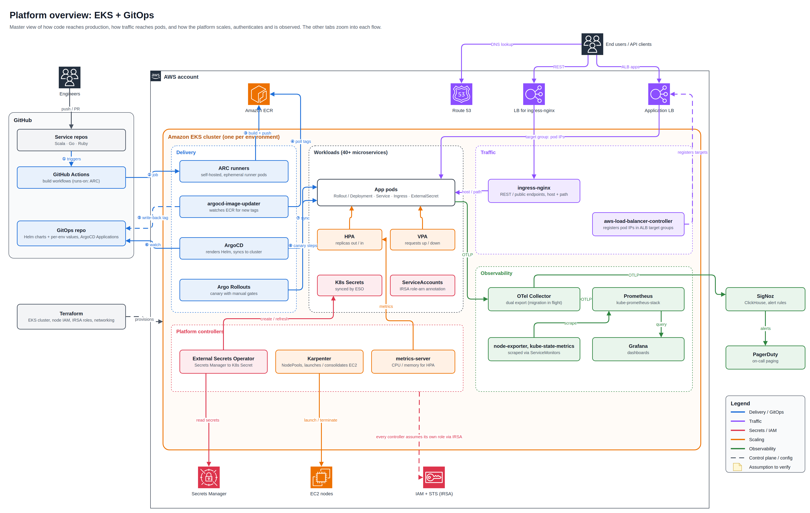
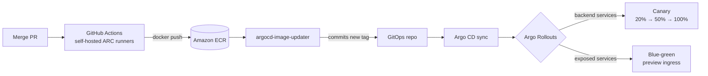

<div align="center">

# Production EKS Platform

### GitOps delivery · Progressive rollouts · Event-driven autoscaling · Keyless AWS access

The production Kubernetes platform on AWS that I personally designed, built and rolled out end to end as lead platform engineer. It runs real production traffic across **300+ instances** and **40+ microservices**, with one EKS cluster per environment and no manual deploys.


</div>

---

| **300+** | **40+** | **0** | **2** | **4** |
| :---: | :---: | :---: | :---: | :---: |
| production instances | microservices (Scala, Go, Ruby) | static AWS keys in the cluster | release strategies, both human-gated | autoscalers working together |

> **Personal delivery, real production.** This is not a lab or a tutorial setup. I owned this platform from design to day-2 operations: the architecture, the Terraform, the delivery pipeline, the rollout strategies, autoscaling, IAM and observability. I moved 40+ live services onto it without stopping production traffic, and I operated it afterwards at 300+ instances.

> Company names, account IDs and hostnames are removed. All diagrams were drawn in draw.io; the editable source is [`diagrams/architecture.drawio`](diagrams/architecture.drawio).

## Architecture



## From merged PR to production



No one runs `kubectl apply` or `helm upgrade` by hand. Every change, including the live image tag, is a commit. That holds for all 40+ services, from every merged PR to every production rollout.

## Highlights

I personally delivered each of these on the live production platform, which runs 300+ instances and 40+ services.

- **Progressive delivery.** Set up Argo Rollouts with its Argo CD UI extension: canary with manual gates for internal services, blue-green with a dedicated preview ingress for exposed services, so new versions are tested without touching live traffic.
- **Observability migration.** Moving from SigNoz to Prometheus + Grafana with zero visibility gap: an OpenTelemetry Collector dual-exports to both, including solving OTel-to-Prometheus metric name translation.
- **Fully GitOps delivery.** Images built on ephemeral self-hosted runners in the cluster, tags written back to Git, Argo CD as the only deployer.
- **Keyless AWS access.** Every controller and service assumes its own least-privilege IAM role through IRSA; secrets come from AWS Secrets Manager via External Secrets Operator.
- **Layered autoscaling.** HPA for CPU / memory, KEDA for queue-driven and scale-to-zero workloads, VPA for right-sizing recommendations, Karpenter for just-in-time nodes.

## Deep dives

| | Area | What's inside |
| :---: | --- | --- |
| 🚀 | [CI/CD and GitOps](docs/01-cicd-gitops.md) | ARC runners, ECR, image-updater git write-back, Argo CD |
| 🚦 | [Progressive delivery](docs/02-progressive-delivery.md) | Canary vs blue-green, manual gates, rollback semantics |
| 🌐 | [Traffic](docs/03-traffic.md) | ingress-nginx vs ALB IP targets, readiness gates |
| 🔐 | [Secrets and IAM](docs/04-secrets-iam.md) | IRSA end to end, External Secrets Operator |
| 📈 | [Scaling](docs/05-scaling.md) | HPA, KEDA, VPA (recommend-only), Karpenter |
| 🔭 | [Observability](docs/06-observability.md) | OTel Collector, Prometheus, Grafana, SigNoz, PagerDuty |

## Design decisions

These are the calls I made and defended for a production fleet of 300+ instances, along with what each one cost.

| Decision | Why | Trade-off |
| --- | --- | --- |
| Image tags written back to Git | Git is the full audit trail; rollback is a commit | A plain revert gets re-overwritten by image-updater unless the tag is pinned first |
| Two ingress paths | ingress-nginx for host / path REST routing; ALB IP targets skip kube-proxy and survive node churn | Routing lives in two places (Git and Terraform) |
| Canary for internal, blue-green for exposed | Internal services get real traffic gradually; exposed ones are tested on a preview hostname first | Blue-green doubles pods during preview |
| VPA in Off mode next to HPA | Avoids the VPA / HPA feedback loop on CPU / memory | Request changes are manual, guided by recommendations |
| KEDA for event-driven workloads | Scales on queue depth, down to zero | Cold start on the first event |
| Dual export during migration | No visibility gap while dashboards and alerts move | Double telemetry load until cut-over |

## What I would improve next

- Bring the ingress-nginx load balancer and Route 53 records under infrastructure as code.
- Finish the alerting migration: PrometheusRules and an Alertmanager PagerDuty receiver, then retire SigNoz.
- Add automated canary analysis (AnalysisTemplates on Prometheus) alongside the manual gates.

## Tech stack

| Layer | Tools |
| --- | --- |
| Infrastructure | AWS, Terraform, Amazon EKS, Amazon ECR, Route 53, ALB / NLB |
| Delivery | GitHub Actions (ARC self-hosted runners), Helm, Argo CD, argocd-image-updater, Argo Rollouts |
| Traffic | ingress-nginx, AWS Load Balancer Controller |
| Security | IRSA, External Secrets Operator, AWS Secrets Manager |
| Scaling | HPA, KEDA, VPA, Karpenter |
| Observability | OpenTelemetry Collector, Prometheus (kube-prometheus-stack), Grafana, SigNoz, PagerDuty |

## Repository layout

```
.
├── README.md
├── docs/          # one page per area
└── diagrams/      # PNG exports + editable draw.io source
```

---

<div align="center">

Designed, built and operated in production by **Abraam** · Platform / DevOps Engineer · [LinkedIn](https://www.linkedin.com/in/YOUR-HANDLE)

</div>
