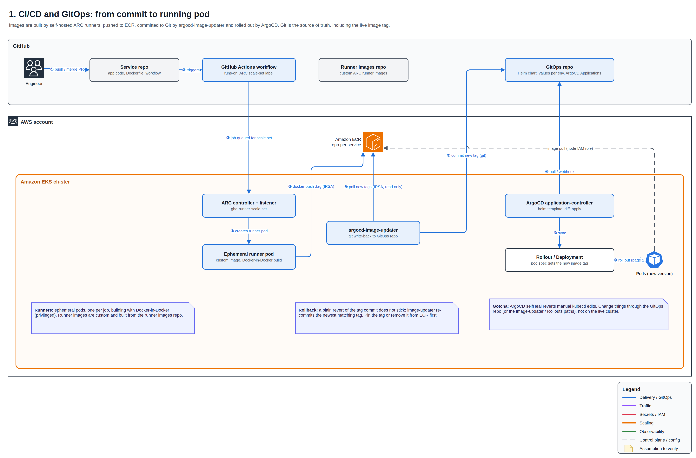

# 🚀 CI/CD and GitOps

A merged PR becomes a running pod with no manual deploy step. CI builds the image, argocd-image-updater commits the new tag to Git, and Argo CD deploys it. Git is the source of truth, including the live image tag.

## How it works

1. An engineer merges a PR in the service repo, which triggers the GitHub Actions build workflow.
2. The job targets an ARC runner scale set; the ARC listener starts an ephemeral runner pod in EKS from a custom runner image.
3. The runner builds the image with Docker-in-Docker and pushes it to ECR, authenticating with IRSA.
4. argocd-image-updater polls ECR, finds the new tag and commits it to the GitOps repo (git write-back).
5. Argo CD detects the commit, renders the Helm chart and syncs the Rollout.
6. Argo Rollouts releases the new pods through canary or blue-green ([progressive delivery](02-progressive-delivery.md)).

## Components

| Component | Runs in | Role |
| --- | --- | --- |
| Service repos | GitHub | App code, Dockerfile, build workflow |
| GitOps repo | GitHub | Helm charts, per-environment values, Argo CD Applications, written-back image tags |
| Runner images repo | GitHub | Custom ARC runner images |
| ARC controller + runners | EKS | Ephemeral runner pod per job |
| Amazon ECR | AWS | One repository per service |
| argocd-image-updater | EKS | Watches ECR, commits new tags to Git |
| Argo CD | EKS | The only deployer: render, diff, apply |

## Design notes

- **Git write-back over in-cluster overrides.** Every deployed tag is a commit, so the GitOps repo always matches production and the history is the deploy log.
- **Ephemeral in-cluster runners.** No long-lived build VMs; runners scale with demand on the same Karpenter-managed nodes.
- **Rollback caveat.** Reverting the tag commit alone does not stick: image-updater re-commits the newest matching tag on its next poll. Pin the tag or remove it from ECR first.

## Troubleshooting

| Symptom | Where to look |
| --- | --- |
| Job stuck in Queued | ARC listener logs; runner pods Pending |
| Push to ECR denied | IRSA role on the runner ServiceAccount |
| New tag in ECR, nothing deploys | image-updater logs: strategy match, Git push errors |
| Commit in Git, app not updated | Argo CD Application sync / render errors |

[← Back to overview](../README.md)
