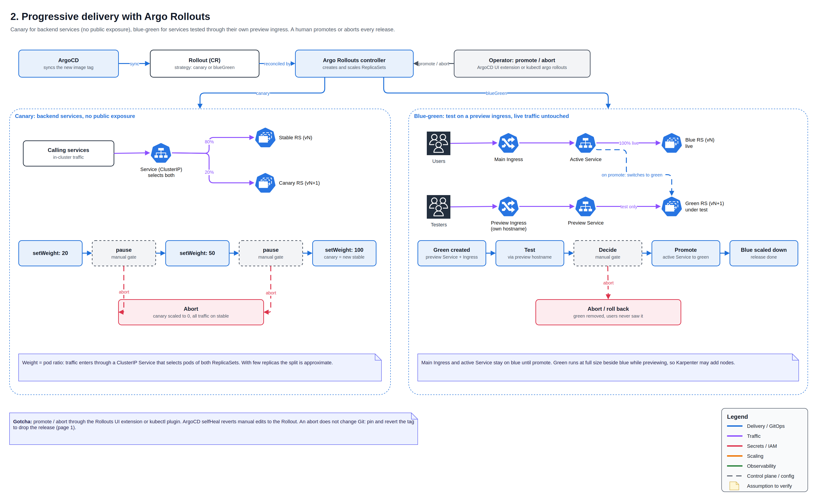

# 🚦 Progressive Delivery with Argo Rollouts

Every release goes through Argo Rollouts with a human deciding when to move forward. Backend services use canary; exposed services use blue-green with their own preview ingress.

## Which strategy when

| | Canary | Blue-green |
| --- | --- | --- |
| Used for | Backend services, no public exposure | Services tested through their own ingress before go-live |
| New version gets | A growing share of real traffic: 20% → 50% → 100% | No live traffic until promote; testers use a preview hostname |
| Decision points | Manual gate after 20% and after 50% | One manual promote |
| Rollback | Abort: canary scaled to 0 | Abort: preview removed, users never saw it |

## Canary

The Rollout creates a canary ReplicaSet next to the stable one. Traffic arrives through a ClusterIP Service that selects both, so the weight is set by pod ratio. The rollout pauses at each gate until someone promotes; abort sends everything back to stable.

## Blue-green

The new (green) ReplicaSet runs at full size beside the live (blue) one. A preview Service and preview Ingress point at green, while the main Ingress and active Service stay on blue. After testing on the preview hostname, promote switches the active Service to green; abort removes green with zero user impact.

## Operating a rollout

| Action | `kubectl argo rollouts` |
| --- | --- |
| Watch | `get rollout <name> -n <ns> --watch` |
| Promote | `promote <name> -n <ns>` |
| Abort | `abort <name> -n <ns>` |
| Retry | `retry rollout <name> -n <ns>` |

The same actions are available in the Argo CD UI through the Rollouts extension.

## Lessons learned

- **Promote and abort through Rollouts, never by editing live objects.** Argo CD selfHeal reverts manual changes.
- **Abort is not a Git rollback.** The new tag stays in the GitOps repo until it is pinned and reverted.
- **Canary weights are approximate** with few replicas: 3 pods cannot give exactly 20%.

[← Back to overview](../README.md)
