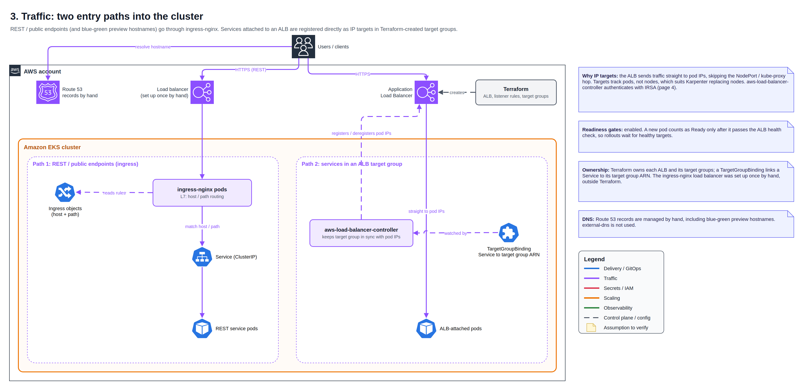

# 🌐 Traffic: How Requests Reach Pods

External traffic enters through one of two paths, chosen per service.

## Two entry paths

| | ingress-nginx | ALB target group |
| --- | --- | --- |
| Used for | REST / public endpoints, blue-green preview hostnames | Services attached to an ALB |
| Flow | Client → load balancer → ingress-nginx → Service → pods | Client → ALB → pod IPs directly |
| Routing | Host and path rules in Ingress objects (Git) | ALB listener rules (Terraform) |
| Kubernetes side | Ingress in the service's chart | TargetGroupBinding linking the Service to a Terraform-created target group |

## Why ALB IP targets

aws-load-balancer-controller registers pod IPs directly in the target group, so traffic skips NodePort and kube-proxy, and targets follow pods rather than nodes. That matters with Karpenter constantly replacing nodes.

**Pod readiness gates** are enabled: a new pod counts as Ready only after it passes the ALB health check, so a rollout does not move on until new pods can serve.

## Troubleshooting

| Symptom | Where to look |
| --- | --- |
| 404 from ingress-nginx | No Ingress matches host / path, or wrong ingress class |
| 502 / 503 from ingress-nginx | Service has no ready endpoints |
| 502 / 503 from the ALB | Unhealthy targets: health check path, security groups |
| Pods not in target group | TargetGroupBinding events, controller logs, IRSA |
| Rollout stuck, pods not Ready | Readiness gate waiting on ALB health check |

[← Back to overview](../README.md)
