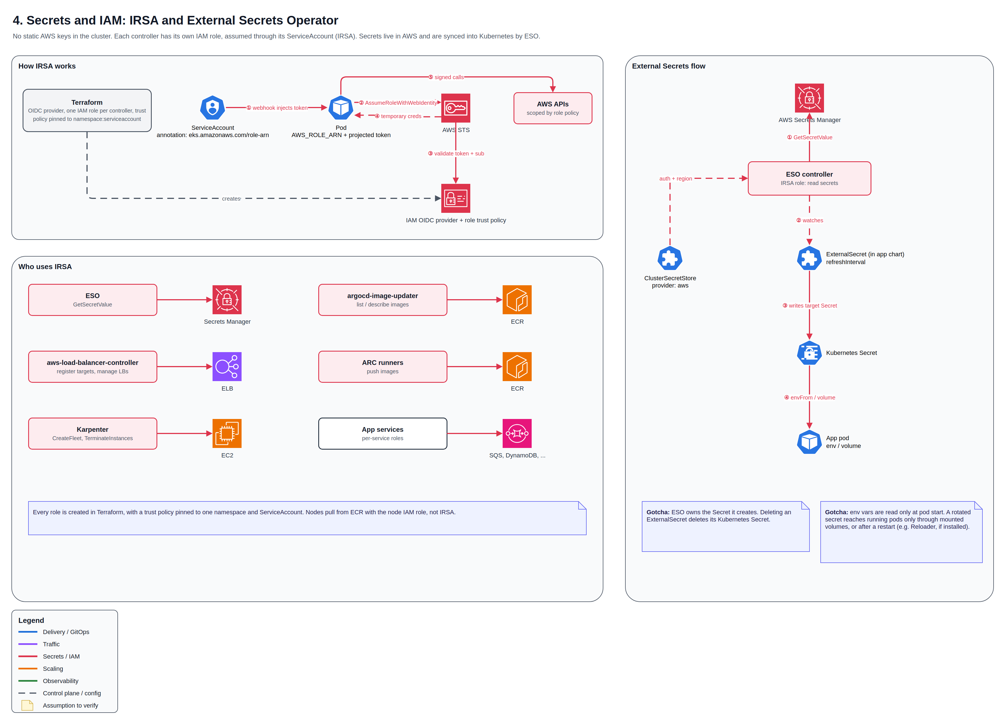

# 🔐 Secrets and IAM: IRSA and External Secrets

There are no static AWS credentials in the cluster. Every controller and service assumes its own IAM role through its ServiceAccount (IRSA), and secrets live in AWS Secrets Manager, synced into Kubernetes by External Secrets Operator.

## IRSA end to end

1. Terraform creates the cluster OIDC provider and one IAM role per workload, with a trust policy pinned to one namespace and ServiceAccount.
2. The ServiceAccount carries `eks.amazonaws.com/role-arn`; EKS injects `AWS_ROLE_ARN` and a projected token into the pod.
3. The AWS SDK exchanges the token with STS (`AssumeRoleWithWebIdentity`) for short-lived, auto-refreshed credentials.

| Workload | AWS access |
| --- | --- |
| External Secrets Operator | Read Secrets Manager |
| AWS Load Balancer Controller | Manage target group registrations |
| Karpenter | Launch / terminate EC2 |
| argocd-image-updater | Read ECR |
| ARC runners | Push to ECR |
| App services | Per-service roles (SQS, DynamoDB, ...) |

## External Secrets flow

A ClusterSecretStore tells ESO how to reach Secrets Manager. Each service's chart defines an ExternalSecret; ESO reads the value with its IRSA role and keeps a Kubernetes Secret in sync on a refresh interval. Rotation is a change in AWS, not in Git.

## Lessons learned

- **Trust policies are pinned to namespace and ServiceAccount**, so renaming either breaks access until Terraform is updated.
- **Misconfigured IRSA can fail silently** by falling back to the node role if pods can reach instance metadata.
- **ESO owns its Secrets**: deleting an ExternalSecret deletes the Kubernetes Secret.
- **Env vars are read at pod start**: rotated secrets need a restart unless mounted as volumes.

[← Back to overview](../README.md)
