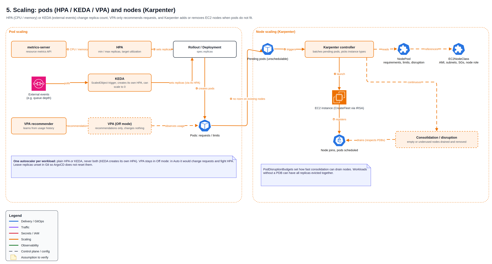

# 📈 Scaling: HPA, KEDA, VPA and Karpenter

Pods scale out and in with HPA (CPU / memory) or KEDA (external events). Nodes follow: Karpenter adds EC2 nodes when pods do not fit and consolidates them when they are no longer needed. VPA only recommends.

## At a glance

| Tool | Changes | Driven by |
| --- | --- | --- |
| HPA | Replica count | CPU / memory from metrics-server |
| KEDA | Replica count, down to zero | External events such as queue depth |
| VPA (Off mode) | Nothing, recommendations only | Usage history |
| Karpenter | Number and type of EC2 nodes | Pending pods, node utilization |

## How the layers interact

1. HPA or KEDA raises replicas on a Rollout.
2. Pods that do not fit on existing nodes go Pending.
3. Karpenter batches them, picks instance types within the NodePool limits, and launches EC2 via the EC2NodeClass.
4. In the other direction, Karpenter drains and removes empty or underused nodes, respecting PodDisruptionBudgets.

## Design notes

- **One autoscaler per workload.** KEDA creates its own HPA; a second HPA on the same target would fight it.
- **VPA in Off mode.** In Auto it would raise requests, lowering HPA utilization and triggering scale-in: a feedback loop. Recommendations feed manual right-sizing instead.
- **No `replicas` in Git for autoscaled workloads**, otherwise Argo CD resets the count on every sync.
- **Scale to zero has a cost:** the first event waits for a pod, and possibly a node, to start.

[← Back to overview](../README.md)
