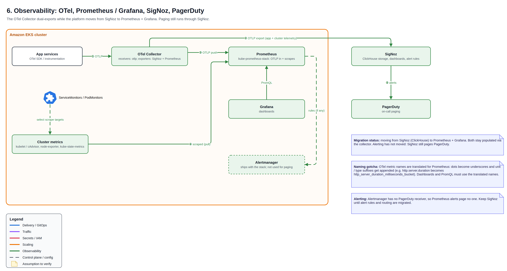

# 🔭 Observability: OTel, Prometheus, Grafana, SigNoz

A live migration from SigNoz to Prometheus + Grafana with no visibility gap. Services send telemetry to an OpenTelemetry Collector that dual-exports to both backends; paging stays on SigNoz → PagerDuty until alerting moves.

## How telemetry flows

1. Services emit OTLP to the OTel Collector.
2. The collector exports to SigNoz and pushes the same metrics to Prometheus.
3. Prometheus also scrapes cluster metrics (node-exporter, kube-state-metrics, kubelet / cAdvisor) through ServiceMonitors.
4. Grafana queries Prometheus; SigNoz alert rules page on-call through PagerDuty.

## Migration plan

| Stage | Status |
| --- | --- |
| Dual export through the OTel Collector | Done |
| Grafana dashboards | In progress |
| Alerting: PrometheusRules + Alertmanager → PagerDuty | Next |
| Retire SigNoz | After alerting runs in parallel |

## Lessons learned

- **Metric names change on the way into Prometheus.** Dots become underscores and unit suffixes are appended: `http.server.duration` becomes `http_server_duration_milliseconds_bucket`. Dashboards must use the translated names.
- **Alertmanager without receivers pages no one.** Until alerting migrates, the old backend cannot be switched off.
- **OTel attributes become Prometheus labels.** High-cardinality attributes must be dropped in the collector.
- **Dual export is temporary** and doubles telemetry load until cut-over.

[← Back to overview](../README.md)
